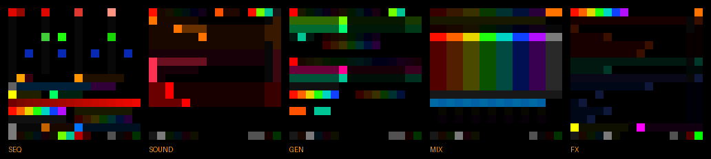

# CLATTER 12

**CLATTER's LXR-02 drum synthesis and generative sequencer, as a native Plinky 12 instrument.**

> **EXPERIMENTAL. Not tested on a Plinky 12.** Everything below that says *works* means in host
> tests, in CLATTER 12's own simulator of the Plinky API, or in a Cortex-M33 cross-compile.

CLATTER 12 brings [CLATTER](https://github.com/clickysteve/clatter), through
[CLATTER Pocket](https://github.com/clickysteve/clatter-pocket)'s embedded engine, to the
[Plinky 12](https://plinky12.com/) as a **custom panel**: one C++ file that Plinky's own IDE
compiles into its firmware. It is not a MIDI controller for another device and not Plinky's synth
renamed: the sound is the Erica Synths LXR-02 firmware's sound engine, run unchanged at its own
44 140 Hz on the Plinky's audio core and converted to the Plinky's 32 kHz.

> CLATTER 12 is an independent project, not an Erica Synths or Plinky product, and is not endorsed by
> either. It contains a modified version of the LXR-02 firmware's sound engine. "Erica Synths",
> "LXR" and "LXR-02" are trademarks of Erica Synths.



## Status

| | |
|---|---|
| Feasibility | **Positive**: Plinky panels are native code with a core-1 audio callback. [FEASIBILITY.md](FEASIBILITY.md) |
| LXR engine | all six voices / seven triggers, unchanged; the LXR firmware's own drive, ring modulator and compressor; compiles into one `#include`-free C++ file (`tools/amalgamate.py`) |
| Sound, host | matches CLATTER Pocket's reference build: every voice's spectrum within 0.03 dB per third-octave band; CLATTER 12's own mix is Pocket's to the bit when the mixer is neutral |
| Panel, simulated | five pages (SEQ, SOUND, GEN, MIX, FX) and Plinky's save page: 127 scripted checks pass in CLATTER 12's simulator of the Plinky API |
| Browser demo | **runs the panel itself**: the firmware source compiled to WebAssembly with the simulator, so the page's grid is the panel's interface. [Page](https://clickysteve.github.io/clatter-12/) |
| Cortex-M33 | compiles with GCC (`-mcpu=cortex-m33 -mfpu=fpv5-sp-d16`), engine and panel: 89 KB code, 27 KB constants, 38 KB static SRAM + 100 KB LXR tables (SRAM or PSRAM); panel object 38 KB of the 128 KB arena. Not linked against Plinky's firmware (not public) |
| CPU, estimated | QEMU's Cortex-M33 model: **168 000 instructions per 2 ms block on average, 244 000 in the busiest** (two LXR blocks); FX add up to 72 000. At 150 MHz that is at least 56 % / 81 % of core 1 before wait states. **Not a measurement of a Plinky** (TESTING.md) |
| Plinky IDE emulator | the first version **compiled, linked and ran** (2026-11-04); this version not yet tried there |
| On a Plinky 12 | **never run** |
| MIDI, CV | not yet (roadmap) |

**Project page:** https://clickysteve.github.io/clatter-12/ (source in `docs/`). The page runs CLATTER 12's panel
source (engine and Plinky glue, exactly the file pasted into Plinky's IDE) with CLATTER 12's simulator of the Plinky API,
compiled to WebAssembly (`docs/assets/c12panel.wasm`, `make wasm`, checked by `make test-wasm`). It is an interface
demonstration, not a Plinky: no pressure sensor, no Plinky delay or reverb, no CPU limit. `make site-serve` runs it locally.

## Playing it (as designed; simulated)

Six pages, Plinky's own (the right side buttons scroll them); row 15's first six pads jump to one. Row 15 is the same
on every page: `SEQ SND GEN MIX FX SAV | page's own | UNDO REDO STOP PLAY`.

| Page | |
|---|---|
| SEQ | rows 0-6: the seven LXR triggers' steps. **Tap** an empty step: on, as loud as you press. **Tap** a lit step: off. **Hold** a lit step: it stays, and rows 8-11 edit it: variation, condition (ALWAYS, 1:2 … 4:4, 25/50/75 %), ratchet (1-8 strokes), roll spacing and velocity run, exact velocity. Row 12 mute and solo, 13 lock and audition, 14 view page (hold + tap: copy), length, swing; 15 GEN, MUT, STYLE, CLR (hold) |
| SOUND | one voice's LXR parameters, a row each, value across the row, `-`/`+` at the end; banks SOURCE, SHAPE, MOD; audition, new sound, mutate sound, lock sound |
| GEN | style, density, complexity, mutation strength, track locks, one-track generate; kit character, wildness, mutation amount, sound locks, new sound / mutate sound per voice, NEW KIT, MUTATE KIT |
| MIX | strips for the seven tracks and the master: mute, solo, an 8-row fader with fine `-`/`+`, pan, delay and reverb sends into Plinky's effects, meters; the master's limiter |
| FX | routing per track; the LXR's drive (TUBE, FOLD, RAT), ring modulator and compressor; bit reduction; the LXR's sample-rate reduction |
| SAVE | Plinky's save/load page: the whole project in a song slot |
| side buttons | Plinky's: tempo (left), pages (right; up from SEQ = CLATTER 12's DSP load page) |

Interface design and rationale: [docs/DESIGN.md](docs/DESIGN.md).

## Building

```bash
git clone --recurse-submodules https://github.com/clickysteve/clatter-12
```

```bash
make
```

That generates `build/clatter_12.cpp` (paste it into the Plinky 12 IDE) and runs every host test.
`make m33` cross-compiles it for the RP2350. Details, variants and installing: [BUILDING.md](BUILDING.md).
Tests and what they do and do not show: [TESTING.md](TESTING.md).

## Documents

- [FEASIBILITY.md](FEASIBILITY.md): how Plinky panels work, resources, LXR portability, obstacles
- [ARCHITECTURE.md](ARCHITECTURE.md): layers, threads, signal path, memory, the amalgamation
- [docs/DESIGN.md](docs/DESIGN.md): the 16 × 16 interface
- [BUILDING.md](BUILDING.md), [TESTING.md](TESTING.md), [ROADMAP.md](ROADMAP.md)
- [NOTICE.md](NOTICE.md), [THIRD_PARTY_NOTICES.md](THIRD_PARTY_NOTICES.md): licences and attribution

## Layout

```
core/             CLATTER 12's portable C: engine wrapper (mix, FX, ratchets), 44.1 -> 32 kHz converter,
                  LXR parameter table, kit generation and mutation
panel/            the Plinky glue (C++, the public panel API only)
sim/              a host stand-in for the Plinky API (NOT Plinky's emulator); its WebAssembly build for the page
tests/            engine, converter, authenticity, C/C++ equivalence, simulated panel, WebAssembly, bench,
                  Cortex-M33 instruction counts in QEMU (tests/m33)
tools/            amalgamator, panel assembler, API check, size report
stubs/sysinc/     empty C library headers for the amalgamation
third_party/      clatter-pocket (submodule, pinned; unmodified)
```

## Licence

GPL-3.0-only with the LXR-02 firmware's additional terms: [NOTICE.md](NOTICE.md).
